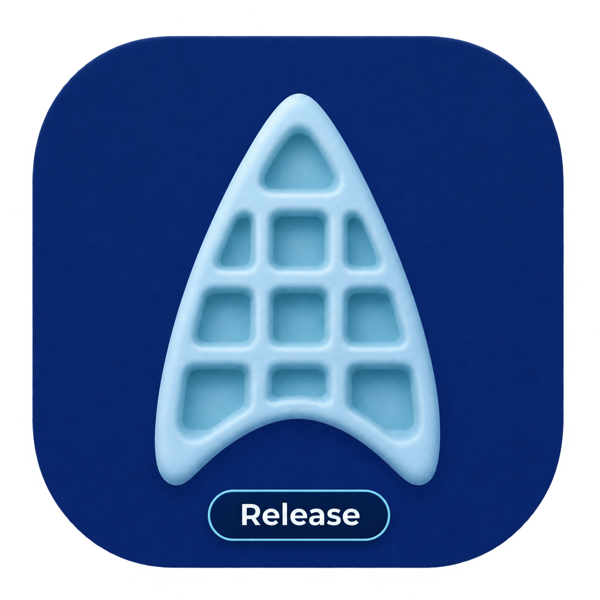

# STFC Community Mod · Guffawaffle’s fork

Guffawaffle’s fork adds player features and settings to the community mod for **Star Trek Fleet Command** on Windows and macOS. [Upstream STFC Community Mod](https://github.com/STFC-Mod/mod)

**[Download the latest signed fork release](https://github.com/Guffawaffle/stfc-mod/releases/latest)** · [Explore STFC tools and projects](https://stfc.smartergpt.dev/)

## Start here

| You want to | Read |
| --- | --- |
| Install or update the mod | [Install the mod](docs/INSTALL.md) |
| Find a setting in-game or in TOML | [Interactive settings guide](https://stfc.smartergpt.dev/projects/community-mod/settings/) |
| Find your settings file | [Settings and file locations](docs/INSTALL.md#change-settings) |
| Find or change a shortcut | [Keyboard shortcuts](docs/KEYMAPPING.md) |
| Use separate game logins | [Profiles setup](docs/PROFILES_PREVIEW.md) |

## Features added in this fork

| Feature | Where to find it |
| --- | --- |
| **Profiles and a redesigned Mac launcher.** Launch separate game logins with their own local settings. The Mac launcher can resize and switch launch targets. | **Profiles** in the Mac launcher, or the separate Windows Profiles ZIP |
| **Galaxy selection and overlays.** Select systems at farther zoom and show station housing and Alliance Starbase indicators together. | **Mod Settings → Galaxy Labels** |
| **Independent pan speeds.** Set different pan speeds in System and Galaxy view. | **Mod Settings → Camera** |
| **Player base badges.** Choose when player base levels and diplomacy icons appear as you zoom. | **Mod Settings → System Labels** |
| **Protected cargo indicators.** Highlight fleets over protected cargo and see an estimate of when your mining fleet will reach that point. | **Mod Settings → Previews & Cargo** |
| **Hyperthermic Decay tracker.** See each amplifier’s hostile level, contribution, and countdown in System view. Click a ring for the game’s buff details. | **Mod Settings → Map & Travel** |

[Feature reference](docs/FEATURES.md)

## Typed IL2CPP architecture

The fork migrated its release core to the typed C++ IL2CPP architecture also used on upstream `dev`. The refactor separates the reusable IL2CPP and Unity libraries from STFC-specific bindings. Features use those bindings to access game fields, properties, and methods. The shared runtime checks metadata and reports missing or changed members. [IL2CPP binding reference](docs/IL2CPP.md)

## Release channels

**Release** is the signed stable download. **Pre** is a signed preview. **DEV** builds come from `play-dev` and include work in progress such as After-Action Intelligence (AAI). [All fork releases](https://github.com/Guffawaffle/stfc-mod/releases)

The public `main` branch tracks full releases. Changes are integrated in `play`. [Release workflow](docs/DOWNSTREAM-RELEASES.md)

## Get help

For fork bugs, include your operating system, game version, full mod version, and relevant lines from `community_patch.log`. [Fork issue tracker](https://github.com/Guffawaffle/stfc-mod/issues) · [Troubleshooting](docs/INSTALL.md#fix-installation-problems)

For general mod help and hotfixes after game updates, check the community Discord. [STFC Community Mod Discord](https://discord.gg/PrpHgs7Vjs)

## Project details

[Build instructions and upstream contribution guide](CONTRIBUTING.md) · [Upstream sponsorship](https://github.com/sponsors/netniV) · [Changelog](CHANGELOG.md)

The mod uses the [GPLv3 license](LICENSE).
[Third-party notices](docs/THIRD_PARTY.md) and
[Windows DLL verification](docs/WINDOWS_DLL_PROVENANCE.md) have their own references.
There is no account-safety guarantee for features added outside this repository.
